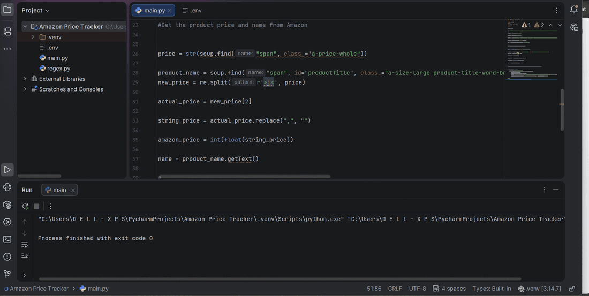

# Amazon Price Tracker

A Python script that checks the price of one Amazon product and emails me when it drops below my budget of ₦150,000.




## Features

- Fetches the product page's HTML with `requests` and reads the product name and price with BeautifulSoup
- Cleans the raw price text into a number so it can be compared with my budget
- Sends an email alert through `smtplib` when the price is under ₦150,000
- Keeps email login details in a `.env` file, not in the code

Prices are in naira. The alert email writes naira as `#`.

## Tech stack

- Python 3
- requests and BeautifulSoup (fetching and parsing)
- `re` (cleaning the price text)
- `smtplib` (sending the email)
- python-dotenv (loading the `.env` file)

## How to run

1. Clone the repo and move into it:
   ```
   git clone https://github.com/<your-username>/<repo-name>.git
   cd <repo-name>
   ```
2. Install the requirements:
   ```
   pip install -r requirements.txt
   ```
3. Create a `.env` file in the project folder (see `.env.example`):
   ```
   PRODUCT_URL=<amazon-product-link>
   EMAIL_ADDRESS=<your-email-address>
   EMAIL_PASSWORD=<your-email-app-password>
   ```
   For Gmail, use an app password, not your normal password.
4. Run the script:
   ```
   python main.py
   ```

The target price is set in `main.py`.

## About this project

This is a course project. The course set the task and left it to us to work out how to pull the price and product name out of the raw HTML and clean them into usable values. I did that part myself.

## What I learned / challenges

- **Selenium got blocked.** My first version used Selenium, and Amazon blocked it. I switched to fetching the page's HTML directly with `requests` and parsing it with BeautifulSoup, which worked for this project.
- **Finding the right element.** It took a lot of trial and error inspecting the page before I picked the right elements for the price and the product name.
- **Turning messy text into a number.** The price arrives as HTML text. I split out the digits, removed the commas, and converted the result so the script could compare it with my budget.

## Possible next improvements

- Run the script on a schedule, so it checks without me starting it
- Track several products from my wishlist in one script
- Show the ₦ symbol in the alert instead of `#`